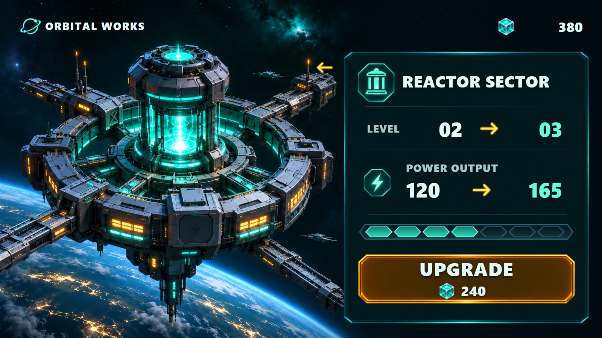

# MobileUICreator

MobileUICreator — скилл `$mobile-ui-creator` для Codex, который помогает проектировать интерфейсы мобильных игр и передавать их в разработку. Подходит для отдельных экранов и HUD, цепочек экранов и модальных окон, а также для создания общего набора UI-ассетов.



## Использование в Codex

1. Скопируйте папку [.agents/skills/mobile-ui-creator](.agents/skills/mobile-ui-creator) целиком в `.agents/skills/` вашего проекта.
2. Откройте целевой проект в Codex, вызовите `$mobile-ui-creator` и опишите экран, действие игрока и нужные состояния. Если есть утверждённый макет или набор ассетов, приложите его или укажите путь.

Пример запроса

> $mobile-ui-creator Спроектируй экран наград за экспедицию. Используй ассеты из `design/ui`. Покажи открытие награды, пропуск анимации и обработку повторного нажатия. Учти длинные названия предметов.

Скилл готовит набор ассетов с манифестом, рецепт раскладки, состояний, действий и анимаций, а также контрольные PNG-кадры. Если в проекте ещё нет утверждённого стиля, он предлагает два или три концепта одного экрана на выбор. Для всего UI игры он составляет карту экранов и прорабатывает один сквозной сценарий.

По умолчанию результаты сохраняются в `design/ui/` целевого проекта. Формат файлов описан в [спецификации передачи в разработку](.agents/skills/mobile-ui-creator/references/handoff.md).

## Быстрый старт

В корне клонированного репозитория выполните команду. Для сборки нужен Node.js 22 или новее.

```sh
node tools/preview.mjs orbital-works
```

Откройте `.artifacts/orbital-works.html` в браузере. HTML содержит все данные и ассеты. В режиме `Interactive` откройте `Reactor Sector` и улучшите реактор. В меню `Timeline` можно просмотреть отдельные кадры переходов и анимаций, а в `Demo` — попробовать разные состояния загрузки.

## Примеры

| Пример | Что можно посмотреть |
| --- | --- |
| **Orbital Works** | Обзор орбитальной станции, улучшение реактора и состояния загрузки. [Рецепт](examples/orbital-works/recipe.md) · [Концепты и исходники](examples/orbital-works/generation.md) · [Кадры](examples/orbital-works/captures) |
| **CatSurvivor** | Портретный экран Journey, детали главы и открытие сундука. [Рецепт](examples/catsurvivor/recipe.md) · [Кадры](examples/catsurvivor/captures) |
| **Shield Drill** | Боевой HUD, обучение щиту и два исхода обрыва связи при выдаче награды. [Рецепт и протокол проверки на телефоне](examples/shield-drill/recipe.md) · [Кадры](examples/shield-drill/captures) |
| **Relay Dispatch** | Постоянные вкладки прогресса, активностей и событий. Каталог из 30 записей с возвратом к исходной позиции. [Рецепт и проверки](examples/relay-dispatch/recipe.md) · [Кадры](examples/relay-dispatch/captures) |

Для сборки демо CatSurvivor нужен доступ к ассетам из отдельной копии проекта CatSurvivor. Скрипт ищет её рядом с MobileUICreator. Если копия находится в другом месте, передайте путь вторым аргументом.

```sh
node tools/preview.mjs catsurvivor
node tools/preview.mjs catsurvivor /path/to/CatSurvivor
```

Откройте `.artifacts/catsurvivor.html`, чтобы перейти из Journey в детали главы через `Enemies` и попробовать открыть сундук или пропустить анимацию. В CatSurvivor и Orbital Works стрелка назад или `Esc` возвращает на предыдущий экран.

Соберите Shield Drill командой `node tools/preview.mjs shield-drill`. Откройте `.artifacts/shield-drill.html`. В `Demo` можно перейти к самостоятельной попытке или выбрать один из двух вариантов обрыва связи. `Data → long-label` включает длинную подпись кнопки щита.

Соберите Relay Dispatch командой `node tools/preview.mjs relay-dispatch`. Откройте `.artifacts/relay-dispatch.html`, чтобы продолжить главу или найти «Ночной конвой» в событиях. Команда `node tools/preview.mjs relay-dispatch --with-new-event` создаёт `.artifacts/relay-dispatch-new-event.html` с ещё одним событием в той же вкладке.

## Проверки

Запустите проверку Orbital Works с установленным Chromium-браузером.

```sh
node tools/check.mjs orbital-works
```

Скрипт проверяет рецепты и манифесты, безопасные зоны, переходы и режим уменьшенного движения. Он обновляет PNG-кадры в папке `captures/` соответствующего примера. По умолчанию используется Microsoft Edge на Windows и команда `chromium` на других системах. Чтобы указать другой браузер, задайте путь к нему в переменной окружения `UI_CHROMIUM`.

Команда `node tools/check.mjs shield-drill` проверяет HUD, касания, обучение и однократное начисление в двух сценариях. Команда `node tools/check.mjs relay-dispatch` проверяет три маршрута касаниями, возврат к строке и добавление события. Команда `node tools/check.mjs` проверяет все четыре примера и требует, чтобы копия CatSurvivor находилась рядом с репозиторием. Запросы для оценки поведения скилла собраны в [evals/evals.json](evals/evals.json). Сравнение первого этапа с предыдущей версией записано в [mobile-ux-baseline.md](evals/mobile-ux-baseline.md).

## Роадмап

В [роадмапе](ROADMAP.md) собраны результаты работы над сценариями игрока и навигацией, а также планы по сезонам, возвращению игроков и прозрачному UX гачи и покупок.

## Лицензия

Код и документация распространяются по [лицензии MIT](LICENSE). Для ассетов и шрифтов из внешнего проекта CatSurvivor действуют их собственные условия.
